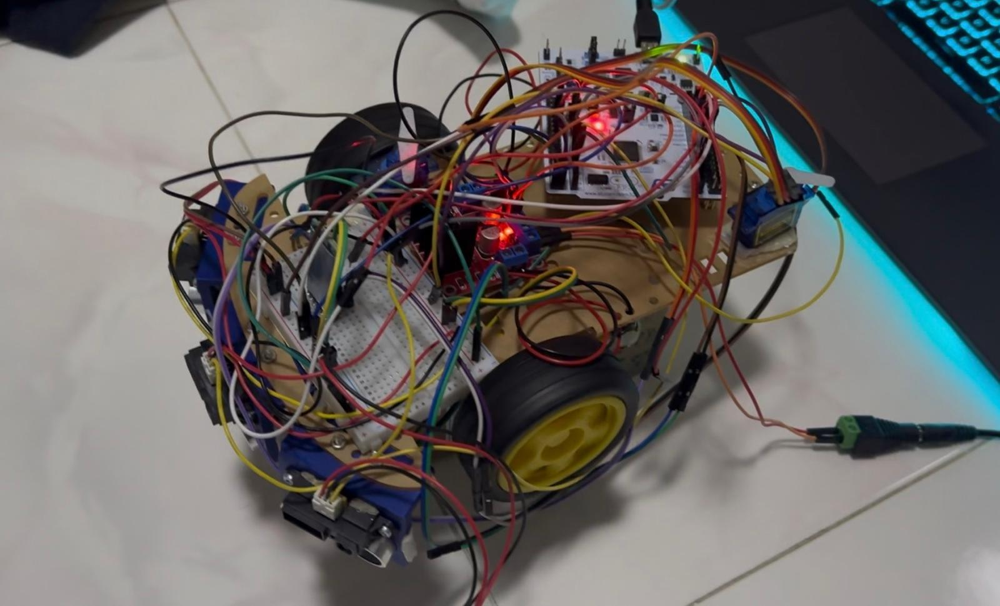
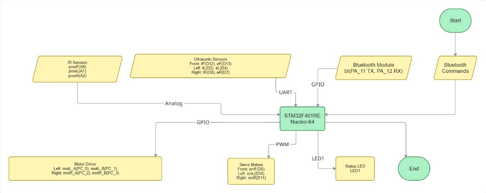
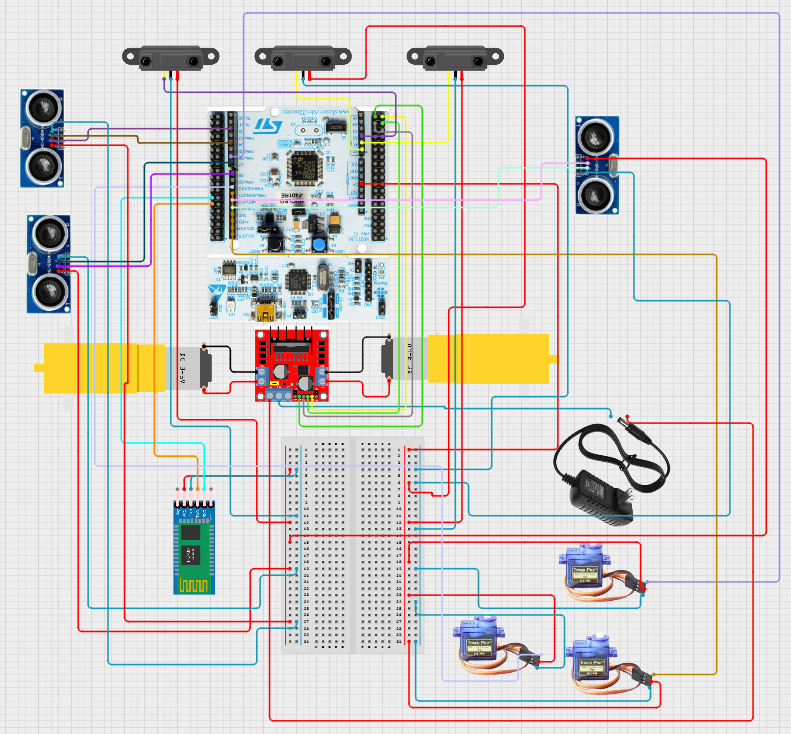
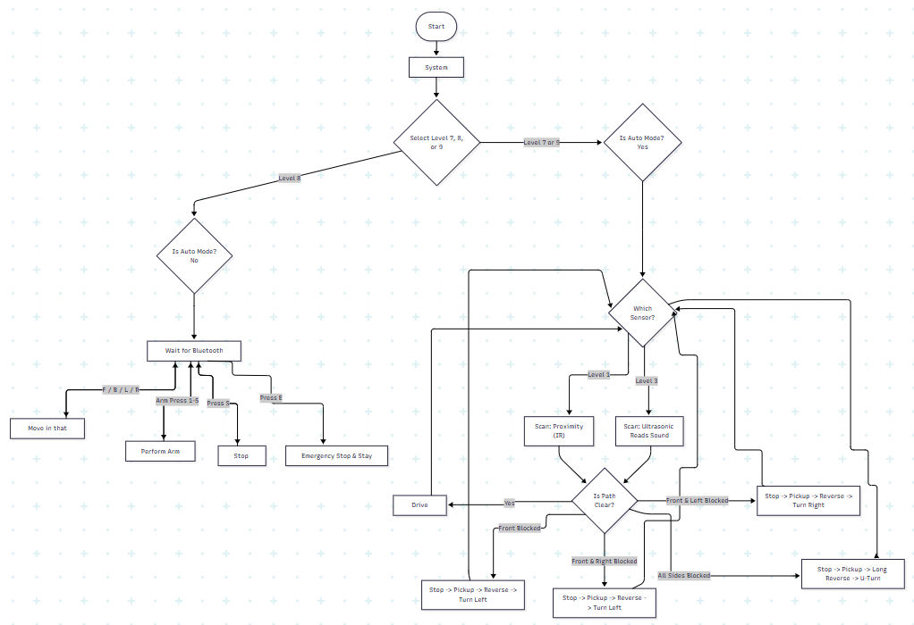
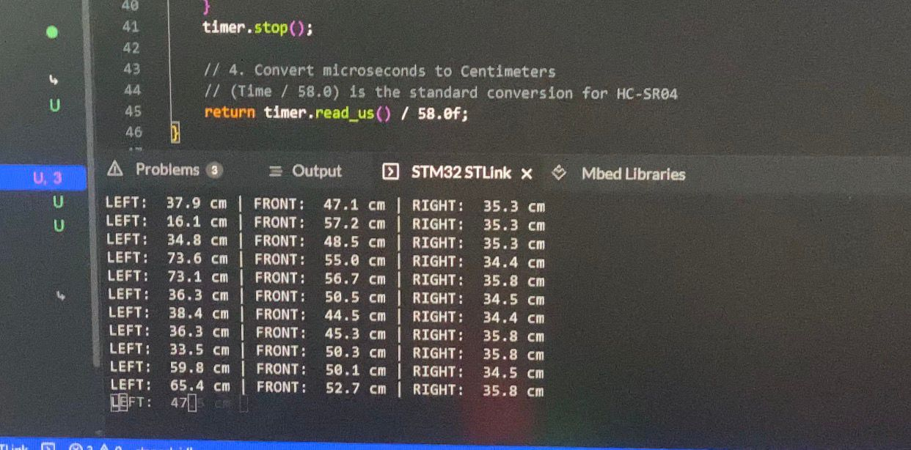

# Bluetooth Obstacle-Avoidance Rover — STM32 Nucleo-F401RE

A two-wheel robot car built on an **STM32 Nucleo-F401RE** running **Mbed OS 2**. It can avoid obstacles on its own using **infrared** or **ultrasonic** sensors, or you can drive it by hand over **Bluetooth**. Three SG90 servos act as simple swing arms: when the car is blocked, it runs a "pick-up" gesture before turning away.

## Features

- **Three operating levels**, chosen over Bluetooth at startup and switchable at any time:

  | Key | Level | Mode | Sensors | Arms used |
  |---|---|---|---|---|
  | `7` | 1 | Autonomous | 3× Sharp GP2Y0A21 **IR** | Front |
  | `8` | 2 | **Manual** Bluetooth driving | — | Front + left |
  | `9` | 3 | Autonomous | 3× HC-SR04 **ultrasonic** | All three |

- **Obstacle avoidance** using a 3-bit left/front/right detection mask with a 10 cm threshold (see the [table below](#navigation-logic))
- **Bluetooth telemetry**: live left/front/right distances are sent back about twice a second
- **Emergency stop** (`E`) works in every mode
- **Fail-safe ultrasonic reading**: if no echo comes back within 25 ms, the reading is set to 400 cm, so a dead sensor can't freeze the control loop

## Hardware

| Component | Part | Interface | Nucleo pins |
|---|---|---|---|
| Microcontroller | STM32F401RE Nucleo-64 | — | — |
| Motor driver | L298N dual H-bridge (ENA/ENB tied high) | GPIO | IN1–IN4 → `PC_0`–`PC_3` |
| Drive motors | 2× DC gear motor, differential drive | via L298N | — |
| Ultrasonic sensors | 3× HC-SR04 | Trig / Echo | Front `D12`/`D13`, Left `D2`/`D4`, Right `D8`/`D7` |
| IR distance sensors | 3× Sharp GP2Y0A21YK0F (10–80 cm) | Analogue | Front `A0`, Left `A1`, Right `A2` |
| Servo arms | 3× Tower Pro SG90 | PWM, 50 Hz | Front `D6`, Left `D10`, Right `D11` |
| Bluetooth | HC-05 (SPP, 9600 8N1) | UART | MCU TX `PA_11` → HC-05 RX, HC-05 TX → MCU RX `PA_12` |

The motors run from a separate 6–12 V battery that shares a ground with the Nucleo. The sensors, servos and HC-05 are powered from the Nucleo's 5 V pin.

| Block diagram | Wiring diagram |
|---|---|
|  |  |

## Bluetooth commands

Connect to the HC-05 from any serial terminal at 9600 baud (it was tested with PuTTY on a laptop) and send single characters:

| Key | Action |
|---|---|
| `7` / `8` / `9` | Choose Level 1 / 2 / 3 |
| `F` `B` `L` `R` | Forward / reverse / pivot left / pivot right (**Level 2 only**) |
| `S` or space | Stop (Level 2) |
| `E` | **Emergency stop**: halts the motors and leaves autonomous mode |
| `1`–`5` | Choose which arms move (1 = left, 2 = front, 3 = right, 4 = all, 5 = front + left), then run the gesture |
| `P` | Run the arm gesture with the current selection |

## How it works

### Sensing
- **Ultrasonic:** `get_us_dist()` sends a 10 µs trigger pulse and times the echo with an Mbed `Timer`. Distance in cm is `t_echo (µs) / 58`. If no echo arrives within 25 ms, it returns 400 cm.
- **IR:** `get_ir_dist()` scales the ADC reading to volts and converts with the curve `d = 27.86 · V^-1.15` (cm). Below 0.1 V it returns 80 cm, meaning nothing in range.

### Navigation logic
In Levels 1 and 3, the main loop reads the active sensors every 50 ms. Each sensor closer than **10 cm** sets one bit: left = 4, front = 2, right = 1.

| L | F | R | Mask | Action |
|:-:|:-:|:-:|:-:|---|
| 0 | 0 | 0 | 0 | Drive forward |
| 0 | 0 | 1 | 1 | Drive forward (side-only contact is ignored) |
| 1 | 0 | 0 | 4 | Drive forward |
| 1 | 0 | 1 | 5 | Drive forward |
| 0 | 1 | 0 | 2 | Stop → arm gesture → reverse 0.5 s → turn **left** |
| 0 | 1 | 1 | 3 | Stop → arm gesture → reverse 0.5 s → turn **left** |
| 1 | 1 | 0 | 6 | Stop → arm gesture → reverse 0.5 s → turn **right** |
| 1 | 1 | 1 | 7 | Dead end: stop → arm gesture → reverse 0.8 s → **U-turn** 1.5 s |

### Motors and arms
- `drive()` sets the four L298N inputs: forward `1010`, reverse `0101`, left `0110`, right `1001`, stop `0000`. The stop pattern brakes the motors instead of letting them coast.
- Each arm is a single SG90 servo. `perform_pickup()` swings the selected servos to 2000 µs, back to neutral (1500 µs), down to 1000 µs, and back to neutral.

## Building and flashing

The project is an **Mbed 2 (classic)** program for the `NUCLEO_F401RE` target, built in **Mbed Studio**.

1. In Mbed Studio, go to **File → Import Program** and choose this repository, or clone it and open the folder. `mbed.bld` pins the Mbed 2 library revision.
2. Set the target to **NUCLEO-F401RE** and build.
3. Plug in the board over USB and flash it. The ST-LINK shows up as a drive, so you can also drag the `.bin` file onto it.
4. Pair your PC or phone with the HC-05, open the Bluetooth COM port at 9600 baud, and press `7`, `8` or `9`.

## Testing summary

| Test | Result |
|---|---|
| HC-SR04 accuracy (10–50 cm) | Mean error under 5 cm; best between 15 and 60 cm |
| GP2Y0A21 accuracy | Within ±4 cm at mid range on light surfaces; reads 5–15 cm too far on black surfaces |
| SG90 positioning | Within 5° of target; 10/10 gesture runs completed |
| L298N direction logic | All 5 drive patterns correct (tested with the wheels lifted off the ground) |
| Bluetooth link | 100 % of commands received at 0.5–1 m; 95 % at 2 m |
| Full autonomous run (Levels 1 and 3) | 10 trials per level on a 1.5 × 1.5 m course; correct avoidance response every time |

## Lessons learned
- **Power noise:** the servos jittered when powered from the L298N's 5 V regulator, because the motors put ripple on that rail. Moving the servos to the Nucleo's 5 V supply and routing the motor wires away from the PWM wires fixed it.
- **Loose breadboard wiring:** vibration loosened 5 V and GND jumpers, so the ultrasonic sensors kept reading 400 cm (no echo). Tighter connectors and one shared ground rail fixed it.
- **UART pin choice:** the HC-05 only worked once it was wired to pins that actually support hardware UART (`PA_11`/`PA_12`). Check the MCU's pin functions in the datasheet before deciding on wiring.
- **Never rewire with power on:** one HC-SR04 was destroyed by hot-swapping a wire while powered. Power off before changing any wiring.

## Known limitations / future work
- Motor speed is fixed at full, because ENA/ENB are tied high. Driving them with PWM would allow speed control.
- The `wait()` calls block, so the robot can't react to commands or sensors while turning or running the arm gesture. Moving to interrupts or an RTOS (Mbed OS 6 threads) would make it more responsive.
- Pin note: on the Nucleo-F401RE, `D13` and `LED1` are the same pin (`PA_5`). The front ultrasonic echo input shares a pin with the status LED.

## Context

Coursework 2 for **5FTC2065 Embedded Systems Design**, BEng Robotics and Artificial Intelligence (University of Hertfordshire, delivered at PSB Academy, Singapore). The brief was to build a robotic vehicle that navigates and avoids obstacles.

## Author

**Steve Flinston** ([@steveerobotclubsmt-create](https://github.com/steveerobotclubsmt-create))
